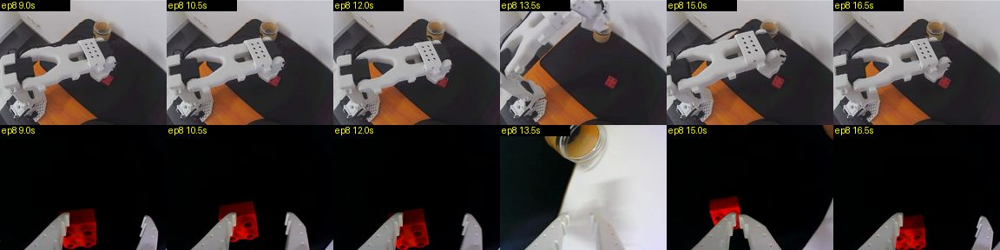
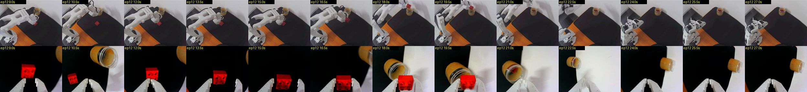
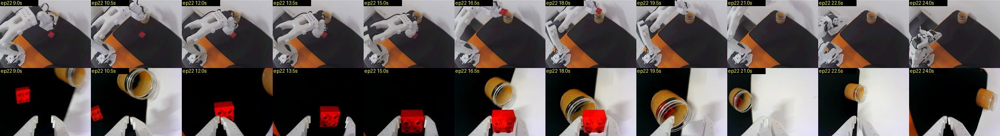
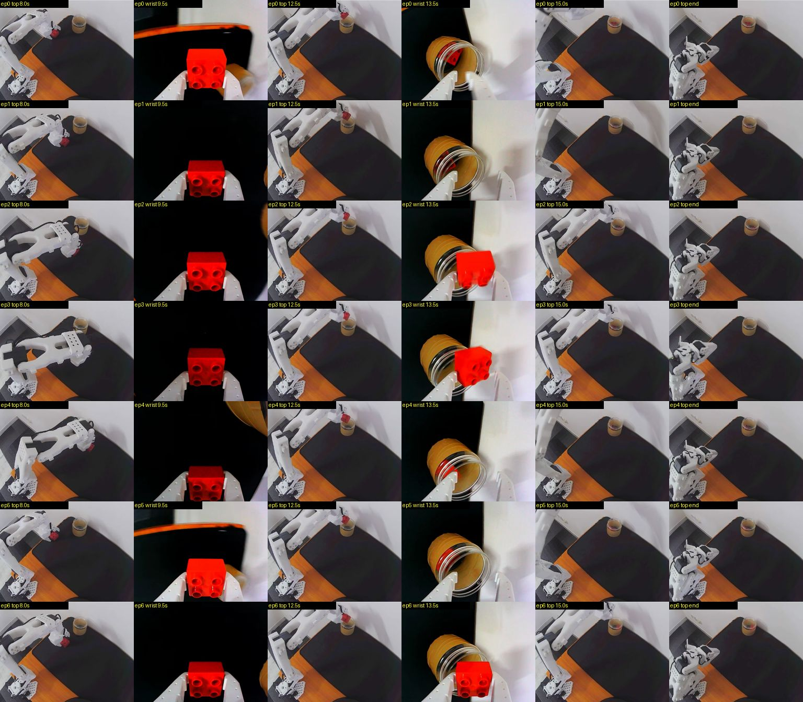
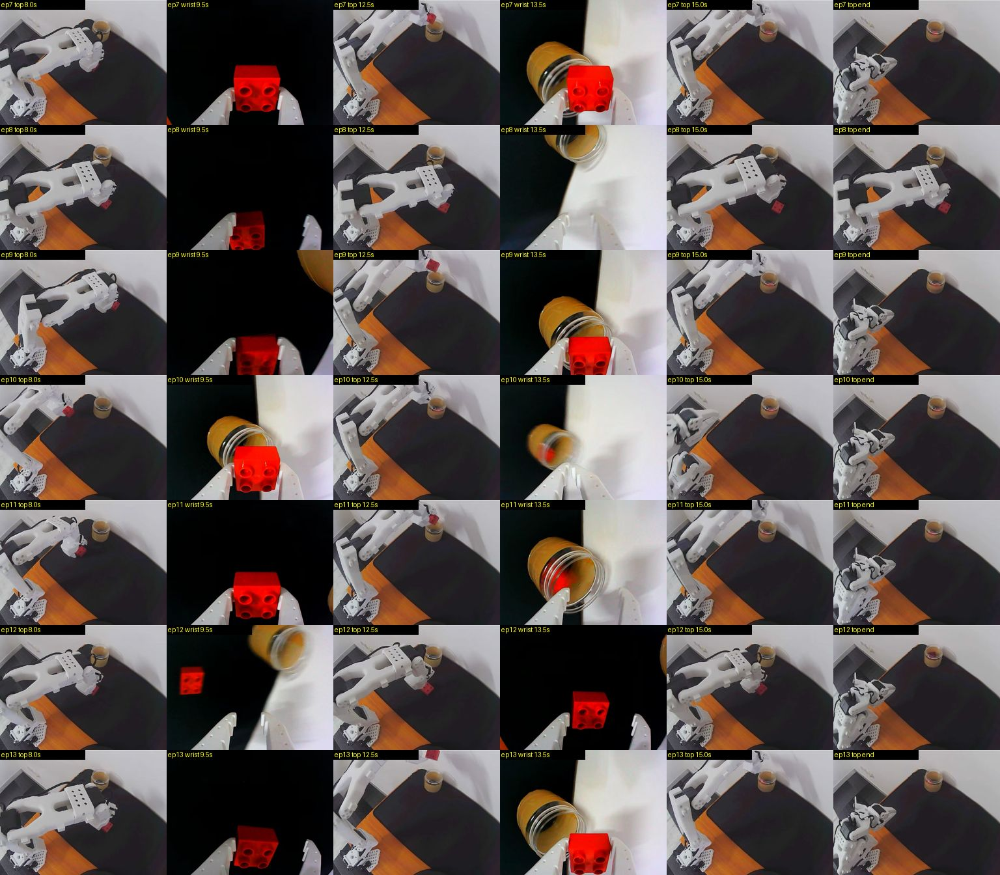
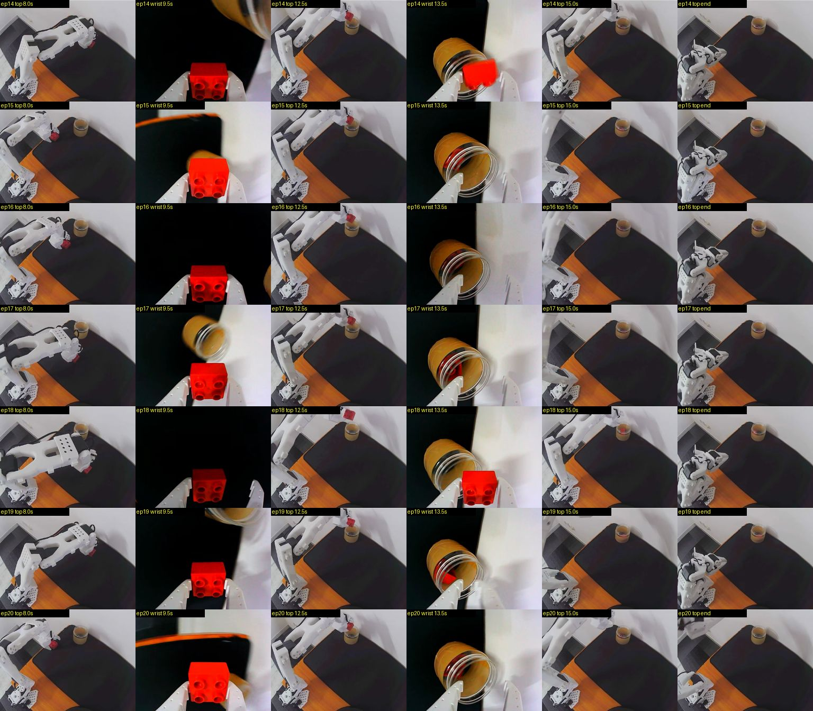
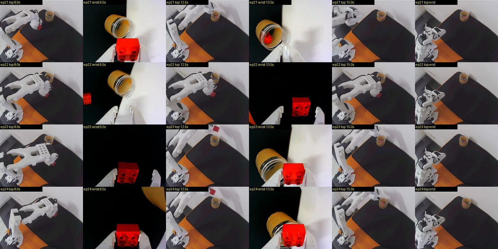

# ACT on block-container: 24 of 25 (2026-11-13)

The ACT policy put the block in the jar in 24 of 25 attempts, 5 at each of the 5 block spots used for the demos. The one failure, at the far-right spot, was a grasp that closed on the edge of the block and lost it. Two more attempts missed their first grasp the same way and recovered.

## Setup

| | |
| --- | --- |
| Command | `uv run so101 run --episodes 25`, started 13:09, finished 13:21 |
| Policy | `gpahal/act_so101_block-container` at `100-demos` (commit `41bf9834`), 100 action steps (3.3 s) per prediction, on the Mac's GPU |
| Training data | 100 demos in 10 sessions, recorded 2026-11-12 |
| Attempt limit | 30 s; every attempt was ended with right arrow before it |
| Block spots | Cycled through the 5 spots of the demos, in order: A, B, C, D, E |
| Lighting | Steady: top camera brightness 95 to 100 of 255 at the start of every attempt (the demos read about 88) |
| Control loop | 29.8 Hz against 30; inference about 44 ms per prediction |

The spots, from the follower's base angle (pan) when it grasped:

| Spot | Where | Pan |
| --- | --- | --- |
| A | left | -14° |
| B | centre | 0° |
| C | right, near | 19° |
| D | far right | 30° |
| E | right, further out (elbow at -25° to -37°) | 20° |

## Results

| Spot | Episodes | Placed | Notes |
| --- | --- | --- | --- |
| A | 0, 5, 10, 15, 20 | 5/5 | |
| B | 1, 6, 11, 16, 21 | 5/5 | |
| C | 2, 7, 12, 17, 22 | 5/5 | 12 and 22 missed the first grasp, then grasped again |
| D | 3, 8, 13, 18, 23 | 4/5 | 8 failed |
| E | 4, 9, 14, 19, 24 | 5/5 | |

A clean attempt grasps at about 8 to 10 s, opens over the jar at 12 to 15 s and is back at rest by about 18 s. The 22 clean attempts ran a median of 19.7 s from start to the right arrow, against 19.1 s for the demos.

| Episode | Spot | Length | Outcome |
| --- | --- | --- | --- |
| 0 | A | 17.6 s | placed |
| 1 | B | 17.8 s | placed |
| 2 | C | 19.7 s | placed |
| 3 | D | 24.3 s | placed |
| 4 | E | 19.0 s | placed |
| 5 | A | 19.5 s | placed |
| 6 | B | 18.9 s | placed |
| 7 | C | 20.5 s | placed |
| 8 | D | 17.9 s | **failed**: grasped the block's edge and lost it |
| 9 | E | 20.8 s | placed |
| 10 | A | 17.7 s | placed |
| 11 | B | 23.4 s | placed |
| 12 | C | 28.4 s | placed on the second grasp |
| 13 | D | 20.2 s | placed |
| 14 | E | 19.6 s | placed |
| 15 | A | 20.1 s | placed |
| 16 | B | 19.3 s | placed |
| 17 | C | 19.3 s | placed |
| 18 | D | 20.3 s | placed |
| 19 | E | 17.9 s | placed |
| 20 | A | 22.7 s | placed |
| 21 | B | 18.0 s | placed |
| 22 | C | 24.7 s | placed on the second grasp |
| 23 | D | 22.1 s | placed |
| 24 | E | 25.4 s | placed |

Outcomes were judged from the camera frames: the block in the jaws on the wrist camera at about 9.5 s, and in the jar on both cameras after the release. The gripper position confirms each one. Holding the block, the gripper stops at 18 to 19; with nothing in it, it closes to 1; on an edge, it stops at 11 to 16.

## The failure and the misses

**Episode 8 (spot D).** The gripper came down with the block against its left jaw instead of centred, closed to 16 on the edge, then slipped to 11 as it lifted. The arm carried nothing to the jar while the block stayed on the mat. The policy went back and had the block between its jaws again at about 16.5 s; the attempt was ended at 17.9 s, before it could lift it.

**Episodes 12 and 22 (spot C).** Both first grasps landed with the block to the left of the jaws, and the gripper closed to 12 on nothing. The policy reopened, grasped properly at about 15 s, and dropped the block in the jar at about 19 to 21 s. Each recovery cost 5 to 9 s.

All three misses had the block to the left of the jaws, and all were at the right-hand spots C and D: 3 misses in 10 grasps there, none in 15 at A, B and E. The policy aims slightly right of the block on that side of the table.

## Compared with the run before

An earlier run of 25 the same day, `uv run so101 run --episodes 25` from 12:49 to 13:02, placed the block in 15. Its top camera brightness jumped from about 100 to 155 and turned warm between attempts 13 and 14, from a change in the room's light: the cameras' exposure and white balance are fixed, and no software touched them then.

| Lighting | Attempts | Placed |
| --- | --- | --- |
| Normal (brightness about 100) | 0 to 13 | 11 of 14 |
| Bright and warm (brightness about 155) | 14 to 24 | 4 of 11 |

In the bright light the policy missed 4 grasps, all with the block left of the jaws, and only the centre spot kept working. In normal light its failures were at spots C and D, as in this run. Lighting matters more than any change to the policy: keep it as it was in the demos, or record demos in other light.

## Next

- Record 10 to 20 more demos at spots C and D, including some with the block a little left of where it usually sits, then train again from this model (`--base`).
- Keep the lighting fixed during runs. `so101 check` prints the top camera's brightness; it read 100 when this run went well.

## Frames

One row per attempt, from left: top camera at 8 s, wrist at 9.5 s, top at 12.5 s, wrist at 13.5 s, top at 15 s, top at the end.

