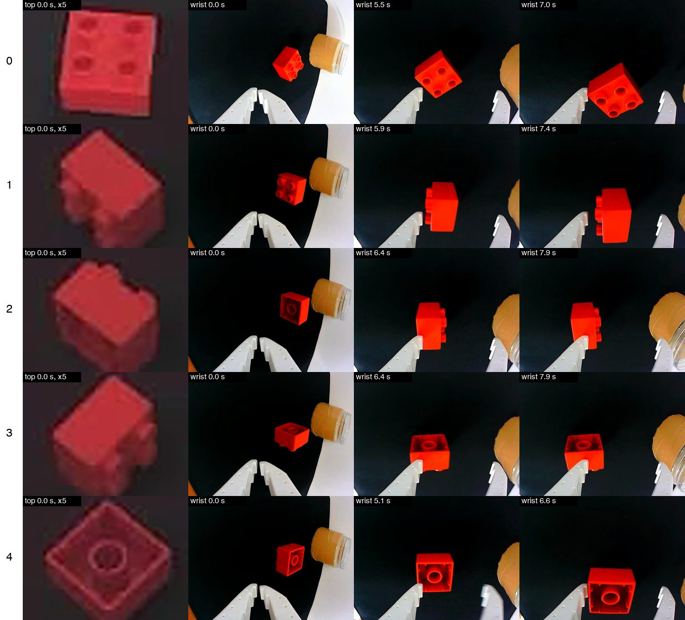
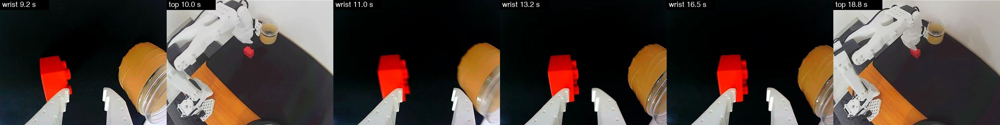
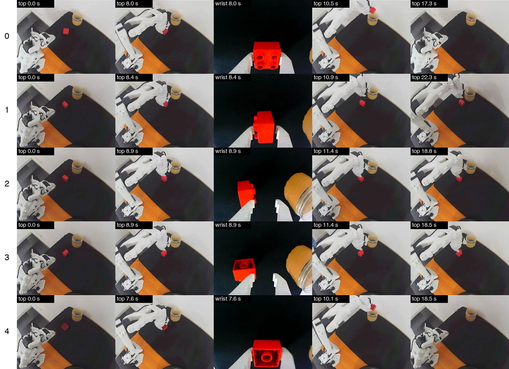

# ACT on block-container with the block turned or tipped: 2 of 5

With the block at one demo spot but lying five different ways, the ACT policy placed it in 2 of 5 attempts: the block turned 45°, which its closing jaws squared up, and the block upside down. It failed on all three blocks lying on their sides. It grasped one of those twice and lost it on lifting both times, and closed beside the other two.

[π0.5 ran the same test](pi05-block-container-block-orientations.md) just before and also placed 2 of 5, but not the same two.

## Setup

| | |
| --- | --- |
| Command | `uv run so101 run --episodes 5` |
| Policy | `gpahal/act_so101_block-container` at `100-demos` (commit `41bf9834`), 100 action steps (3.3 s) per prediction, on the Mac's GPU |
| Training data | 100 demos in 10 sessions. In every one the block stands upright with its studs up, turned the same way at each spot |
| Block | At spot B, the centre spot, in all 5 attempts, within 13 px of the spot's centre in the top camera's picture. A different way up in each attempt, listed below |
| Jar | Near its usual place: within 10 px of the demos in attempt 0, and 20 to 27 px to the right in attempts 1 to 4 |
| Attempt limit | 30 s; every attempt was ended with right arrow before it |
| Lighting | Top camera brightness 120 of 255 at the start of attempt 0 and 104 to 106 in the others (the demos read about 86, the [baseline](act-block-container-baseline.md) 95 to 100) |
| Top camera | Out of place by 8 to 9 px |
| Control loop | 29.6 Hz against 30 |

With the usual block, this model placed 5 of 5 at spot B in the baseline.

## Results

| Attempt | How the block lay | Outcome |
| --- | --- | --- |
| 0 | upright, turned 45° | **placed**: the closing jaws squared it up |
| 1 | on its side, studs towards the arm | **failed**: grasped it twice and lost it on lifting twice |
| 2 | on its side, studs away from the arm | **failed**: closed beside it, three times |
| 3 | on its side, studs to the arm's right | **failed**: closed beside it, three times |
| 4 | upside down, studs on the mat | **placed** |

Outcomes were judged from the camera frames: the block's place on the wrist camera before and after the gripper closed, and in the jar or on the mat on the top camera at the end. The gripper position agrees for the two placements: it stopped at 19, the width it holds the upright block at. It doesn't settle the other three. ACT commands a width of 14 to 16 when it closes, and the gripper reached that width whether or not anything was in it.

## Each attempt

**Attempt 0, turned 45°.** The arm came down with the block corner-on between its open jaws, well inside them. As the jaws closed, at 8 s, they turned the block until two flat sides met them. The gripper stopped at 19, and the carry and release were as in the baseline: let go over the jar at 12 s, back at rest by 15.5 s. π0.5 lost the same block: its jaws closed with the block nearer their tips, and it slid out ahead of them.

**Attempt 1, on its side with the studs towards the arm.** The jaws closed around the block where it lay, at 8.5 s. As the arm lifted and swung towards the jar the block slipped out and stayed on the mat. The arm went to the jar empty, came back, grasped the block again at 16 s, lifted at 18.5 s, and lost it the same way. It had gone to the jar with empty jaws a second time and was coming back when the attempt was ended at 22.4 s. The block finished 23 px from where it started, about half its width.

**Attempts 2 and 3, on its side with the studs away and to the right.** In both, the arm stopped with the block to the left of its left jaw instead of between the jaws, and closed on nothing. It opened and closed again from the same place, three times in all in each attempt, at about 9 s, 13 s and 16 s. The block moved 8 px and 3 px.

**Attempt 4, upside down.** As with the upright block: held from 7.5 s at a width of 19, let go over the jar at 12 s, back at rest by 15 s.

## What the attempts have in common

- **The reach never changed.** Base angle, shoulder lift and elbow as the jaws opened over the block were the same in all five attempts, within 3°. The wrist's roll stayed at -2° to -4°. The policy did what it does at this spot, whatever lay there.
- **What decided the outcome was the block's outline between the jaws.** Upside down, the block has the same square outline at the same height: placed. Turned 45° and well inside the jaws, it was squared up by them: placed. On its side it is taller and narrower: the one grasp that held it didn't hold it through the lift, and the other two stopped beside it.
- **Nothing shows the policy noticing the difference.** It didn't turn its wrist, open wider or come in higher for any of them.

## Compared with π0.5

| How the block lay | ACT | π0.5 |
| --- | --- | --- |
| upright, turned 45° | **placed**: the closing jaws squared it up | failed: slid out of the closing jaws |
| on its side, studs towards the arm | failed: grasped twice, lost it on lifting twice | **placed**, after tipping it upside down |
| on its side, studs away from the arm | failed: closed beside it | failed: pushed away |
| on its side, studs to the right | failed: closed beside it | failed: never closed |
| upside down | **placed** | **placed** |

Both placed 2 of 5, and both placed the upside-down block. The turned block separates them by a few millimetres of where the jaws closed. ACT opens its gripper a little wider, to 35 to 37 against 32 to 33, and closed with the block deeper between its jaws. Neither policy picked up and placed a block that was still on its side.

## What this doesn't show

- **A rate.** Each way up was tried once, at one spot.
- **Whether the camera and jar being out of place mattered.** The camera was 8 to 9 px off and the jar up to 27 px. Both placements were made with them like that, and in an earlier control ACT placed 3 of 3 with the jar 14 to 21 px off.

## Next

- To handle a block turned or lying on its side, record demos with it that way, and with the wrist turning to match. All 100 demos have one way up and no wrist roll.
- To get a rate, run each way up 5 times.

## Frames

One row per attempt, from left: top camera at the start, top camera and wrist camera when the gripper first closed, top camera 2.5 s later, top camera at the end. Each frame is labelled with its camera and time.

