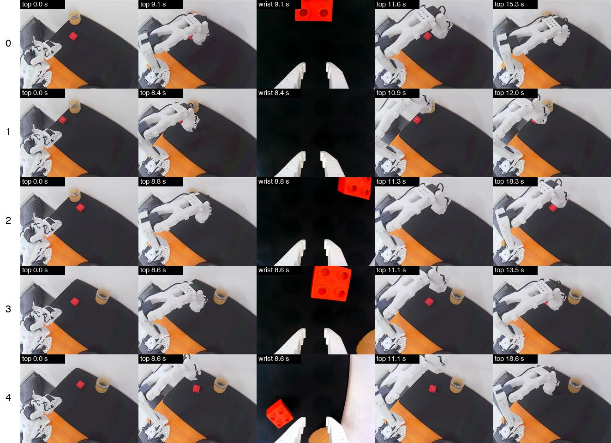
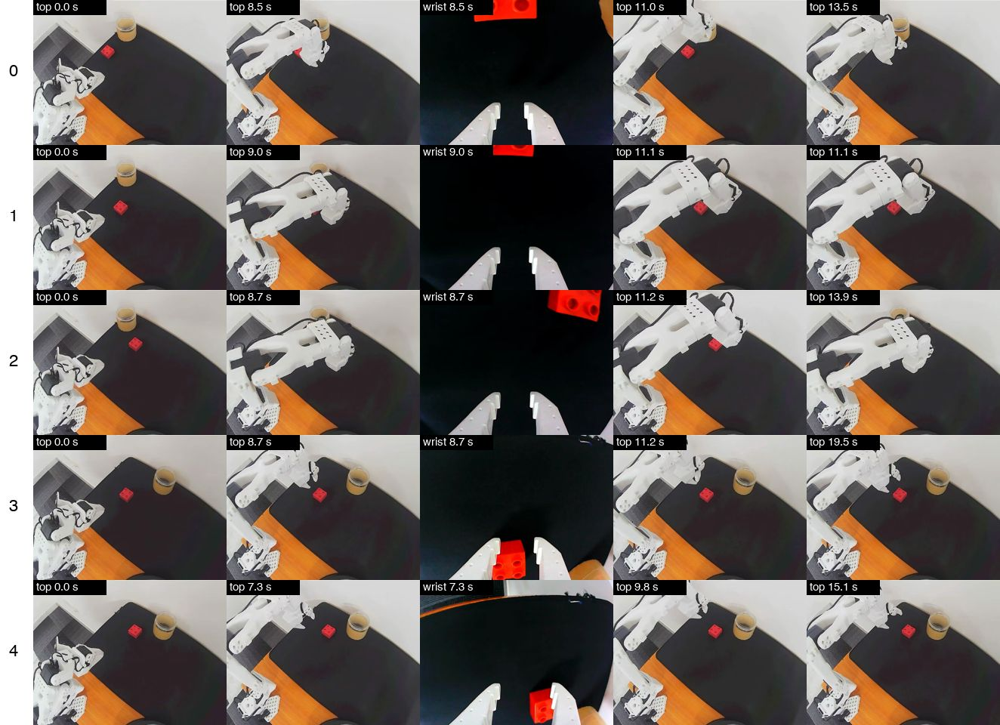
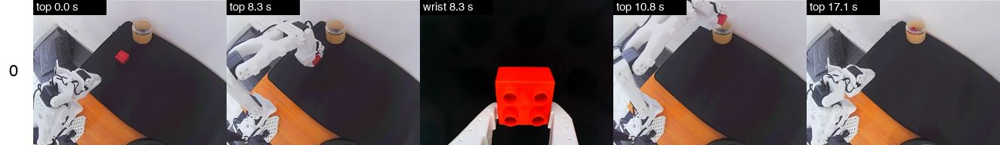
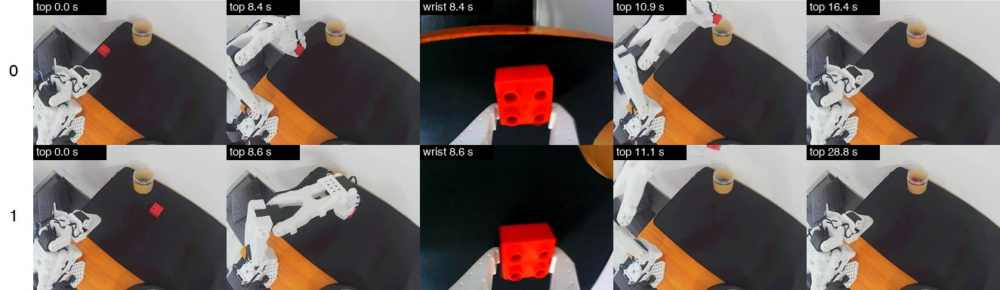

# ACT on block-container with the jar moved: 0 of 10

With the jar moved about one jar width from its place in the demos, the ACT policy didn't pick up the block in any of 10 attempts, in two runs. It failed before the jar mattered: the arm reached for the wrong spot, up to 22° of base rotation away from the block, and closed its gripper beside it. In 3 attempts just before, with the jar in its usual place, it placed the block every time.

## Setup

| | |
| --- | --- |
| Commands | `uv run so101 run --episodes 5`, twice, 5 attempts each |
| Policy | `gpahal/act_so101_block-container` at `100-demos` (commit `41bf9834`), 100 action steps (3.3 s) per prediction, on the Mac's GPU |
| Training data | 100 demos in 10 sessions. The jar is in one place in all of them |
| Jar | Moved by about its own width: to the left for attempts 0 to 2 of each run, to the right and nearer the arm for attempts 3 and 4 |
| Block | At demo spots A and B in 6 attempts (within 10 px of a demo's block), and 33 to 45 px from the nearest demo in the other 4 |
| Attempt limit | 30 s; every attempt was ended with right arrow before it, after 11 to 20 s |
| Lighting | Top camera brightness 113 to 126 of 255 at the start of each attempt (the demos read about 86, the [baseline](act-block-container-baseline.md) 95 to 100) |
| Top camera | Out of place: the scene sat 18 px from where it is in the demos in the first run, and 6 px in the second, in a picture 640 px wide |

One more attempt in the second run was thrown away with left arrow after 16.2 s and repeated as attempt 1. Its frames weren't saved.

Distances are in pixels of the top camera's picture, measured in the first frame of each attempt and corrected for the camera being out of place. The jar is about 70 px wide there.

## Results

| Run | Jar | Attempts | Block picked up | Placed |
| --- | --- | --- | --- | --- |
| Control, before the first run | In its usual place (14 to 21 px off) | 3 | 3 | 3 |
| First | Moved 82 to 86 px | 5 | 0 | 0 |
| Second | Moved 64 to 81 px | 5 | 0 | 0 |

The first row is the control. Those 3 attempts ran just before the first run, in the same light, with the camera 9 to 18 px out of place. The arm aimed within 1° to 3° of where the demos grasp at each spot, held the block at a gripper width of 18.5 to 18.9, and dropped it in the jar. So neither the light nor the camera explains the failures below: the second run had the camera closer to its place than any of the three.

**First run**

| Attempt | Jar moved | Block | Aim at the grasp | Gripper closed to | What happened |
| --- | --- | --- | --- | --- | --- |
| 0 | 82 px left | spot B | 16° right (16° against 1°) | 13.8 | closed on nothing, block ahead of the jaws |
| 1 | 86 px left | spot A | 22° right (7° against -15°) | 10.1 | closed on nothing |
| 2 | 82 px left | 44 px from spot B | 18° right (19° against 1°) | 12.2, then 13.2 | closed twice on nothing |
| 3 | 84 px right | spot B | 16° right (16° against 1°) | 12.5 | closed on nothing |
| 4 | 83 px right | 45 px from spot B | on target by angle (0° against 1°), short in reach | 12.7, then 17.4 | closed on nothing, then pinched the block for 0.9 s and lost it |

**Second run**

| Attempt | Jar moved | Block | Aim at the grasp | Gripper closed to | What happened |
| --- | --- | --- | --- | --- | --- |
| 0 | 79 px left | spot A | 19° right of the block (base at 4°, the demos at -15°) | 9.7 | closed on nothing, block ahead of the jaws |
| 1 | 81 px left | spot B | 18° right (20° against 2°) | 11.3 | closed on nothing |
| 2 | 76 px left | 33 px from spot B | 21° right (22° against 1°) | 12.0 | closed on nothing |
| 3 | 66 px right | spot B | 7° left (-6° against 1°) | 13.6, then 14.5 | closed twice on the block's edge |
| 4 | 64 px right | 37 px from spot B | 11° left (-10° against 1°) | 19.9 | pinched the block for 1.4 s, then lost it |

Outcomes were judged from the camera frames: where the block is on the wrist camera when the gripper closes, and where it is on the top camera at the end. The block was still on the mat at the end of all 10 attempts, and the jar was empty. The gripper position agrees: holding the block it stops at 18 to 19, and it only reached that width in the two attempts that pinched the block and lost it.

"Aim" is the follower's base angle when the gripper first closed, against the median base angle at the grasp in the 5 demos whose block started nearest.

## What moved the aim

With the jar to the left, the arm aimed 16° to 22° to the right of the block in all 6 attempts. With the jar to the right, it aimed 7° and 11° to the left in 2 attempts, 16° to the right in 1, and at the right angle but short in 1.

The block was at a demo spot in 6 of the 10 attempts, and at spot B in 4 of those. In the baseline ACT grasped at spot B in 5 of 5 attempts. So the policy doesn't find the block from the block alone: where the jar is in the picture changes where the arm goes. In the 100 demos the jar never moved, so the policy had nothing to teach it that the jar's place and the block's place are separate.

## What this doesn't show

- **Where ACT would drop the block.** No attempt carried the block, so the run says nothing about whether ACT follows the jar or goes to its old place.
- **How far the jar can move before this starts.** Both runs moved it by about its own width. With the jar 14 to 21 px off, in the control, the arm still aimed right.

## Compared with π0.5

[π0.5 ran the second run's placements](pi05-block-container-moved-container.md) and placed 0 of 5 as well, but it failed later. With the block at a demo spot it aimed within 1° of the demos and picked the block up in 3 of 3 attempts, where ACT aimed 7° to 19° off and picked up none. It then carried each block to where the jar used to be and let go there. With the block at a new spot, neither policy picked it up.

## Next

- Put the top camera back before any more runs. The earlier reviews had it within 3 px of the demos.
- To make ACT cope with a moved jar, record demos with the jar in several places. More demos with the jar in its usual place won't help.

## Frames

One row per attempt, from left: top camera at the start, top camera and wrist camera when the gripper first closed, top camera 2.5 s later, top camera at the end. Each frame is labelled with its camera and time.

