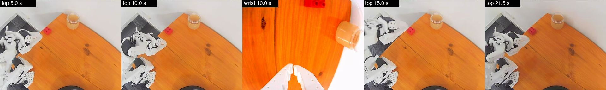
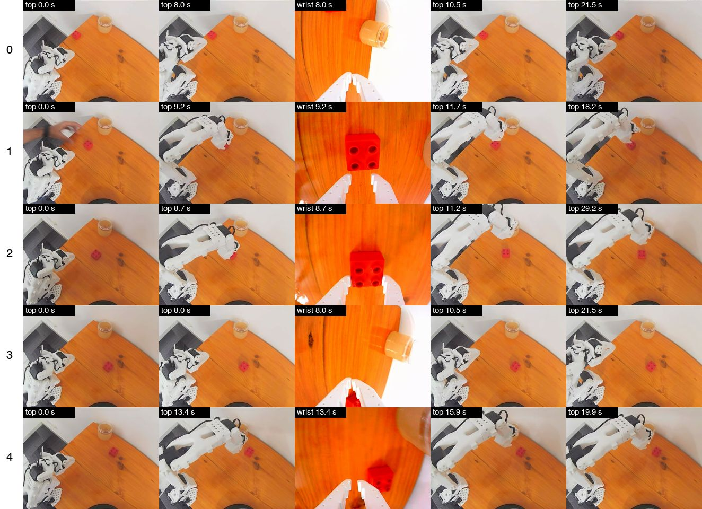

# ACT on block-container without the mat: 0 of 5

With the black mat taken away and the block and jar on the bare wooden table, the ACT policy didn't pick up the block in any of 5 attempts, one at each of the 5 demo spots. In 2 attempts it never left its start pose: the arm twitched above the base for 21.6 s with its gripper shut. In the other 3 it reached the table and closed its gripper short of the block or beside it.

[π0.5 ran the same test](pi05-block-container-no-mat.md) just before and placed 2 of 5.

## Setup

| | |
| --- | --- |
| Command | `uv run so101 run --episodes 5` |
| Policy | `gpahal/act_so101_block-container` at `100-demos` (commit `41bf9834`), 100 action steps (3.3 s) per prediction, on the Mac's GPU |
| Training data | 100 demos in 10 sessions, all on the black mat |
| Surface | The bare wooden table: orange-brown, with visible grain and two dark knots near spot E. The block also sits lower than in the demos, by the mat's thickness |
| Jar | In its usual place, within 4 px of the demos in the top camera's picture |
| Block spots | The 5 spots of the demos, in order: A, B, C, D, E, each within 10 px of a demo's block |
| Attempt limit | 30 s; every attempt was ended with right arrow before it, attempt 2 at 29.3 s |
| Lighting | Top camera brightness 131 to 154 of 255 at the start of each attempt (the demos read about 86, the [baseline](act-block-container-baseline.md) 95 to 100). The wood is brighter than the mat |
| Top camera | In place: 1 to 4 px from where the scene is in the demos |
| Control loop | 29.6 Hz against 30 |

A hand was in the top camera's picture in the first frame of attempt 1.

## Results

| Attempt | Spot | Left the start pose | Gripper closed to | What happened |
| --- | --- | --- | --- | --- |
| 0 | A | no | never opened | twitched above the base for 21.6 s |
| 1 | B | yes | 11.3, then 6.3 | closed short of the block at 9.2 s and again at 16.5 s |
| 2 | C | yes | 10.5, then twice more | closed short of the block at 8.7 s, 16.7 s and 28.7 s |
| 3 | D | no | never opened | twitched above the base for 21.6 s |
| 4 | E | yes | 16.7 | reached out, pulled back almost to rest, came out again short, and closed beside the block at 13.4 s |

Outcomes were judged from the camera frames: where the block is on the wrist camera when the gripper closes, and on the top camera at the end. The block was on the table at the end of all 5 attempts, and the jar was empty. The gripper never stopped at 18 to 19, the width it holds the block at.

With the mat this model placed 24 of 25 in the baseline, and 3 of 3 in a control earlier in this session.

## The two that never started

In attempts 0 and 3 the arm stayed folded above its base. Its shoulder lift moved between -104° and -26°, where a reach needs it above 10°, and its gripper stayed shut. The commands jumped by up to 33° between two frames, and the shoulder lift changed direction 191 and 170 times.

ACT predicts 3.3 s of motion at a time and plays it without looking again. Every jump over 8° in the commands falls exactly 100 frames after the last, where one prediction hands over to the next. Each new prediction disagreed with the one before, so the arm went back and forth without committing to a reach.

## The three that reached

| Attempt | Spot | Base, shoulder lift, elbow while the jaws were open | Demos at the grasp |
| --- | --- | --- | --- |
| 1 | B | 6°, 10°, 18° | 3°, 18°, 12° |
| 2 | C | 13°, 16°, 5° | 13°, 11°, 21° |
| 4 | E | 12°, 14°, -4° | 19°, 47°, -33° |

At B and C the arm went roughly where the demos go and stopped with the block beyond the tips of its jaws. At E it stopped far short: the demos reach out with the elbow at -33°, and it stopped at -4°. All three closed without the block between the jaws, opened, and tried again from the same place.

The motion was rough in these too: 64 to 93 shoulder lift direction changes per attempt, against 3 to 15 in the baseline.

## Compared with π0.5

| | ACT | π0.5 |
| --- | --- | --- |
| Placed | 0 of 5 | 2 of 5 |
| Picked up the block | 0 of 5 | 2 of 5 |
| Reached the block | 3 of 5 | 5 of 5 |
| Shoulder lift direction changes per attempt | 64 to 191 | 3 to 34 |

Both policies learned from the same 100 demos on the mat. π0.5 kept its smooth motion on the wood and did the whole task at 2 spots. ACT's motion broke down everywhere.

## What this doesn't show

- **Whether the picture or the height matters.** Taking the mat away changes what the cameras see and lowers the block by the mat's thickness. This run can't separate the two, though a height change wouldn't explain the two attempts that never started.
- **How much is the brightness.** The wood made the top camera's picture brighter than in any earlier ACT run but one, and ACT placed 4 of 11 in that one.
- **A rate.** This is 5 attempts, one per spot.

## Next

- To make ACT work on another surface, record demos on more than one surface. All 100 are on the mat.
- To test the picture alone, put a thin sheet of another colour over the mat, so the block stays at the same height.

## Frames

One row per attempt, from left: top camera at the start, top camera and wrist camera at 8 s or when the gripper first closed, top camera 2.5 s later, top camera at the end. Each frame is labelled with its camera and time.

