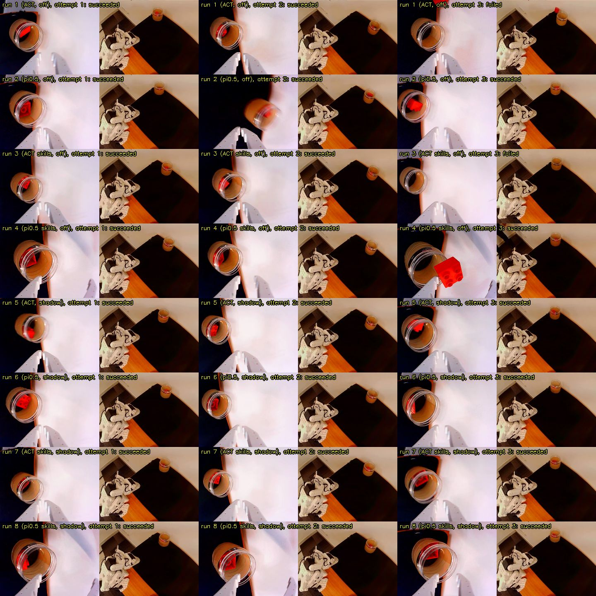
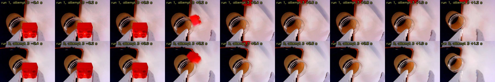
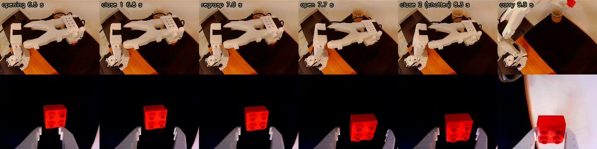

# ACT and π0.5 on block-container, with the supervisor off and in shadow: 22 of 24

Eight `so101 run` runs of 3 attempts each: ACT and π0.5, each as a whole-task model and as a skills model, each first with the supervisor off and then in `shadow`. The policies placed the block in 22 of 24 attempts. Both failures were ACT, at the same block spot, in the runs with the supervisor off: the jaws opened beside the jar's rim and the block bounced out.

In `shadow` the supervisor judged 12 attempts, every one a success, and raised no false alarm. It could not have acted on any of them, though: its second judge always answered too late for a playback, and its first judge never scored low enough to call a release done. Those findings changed the supervisor's program to version 2 ([`docs/supervisor.md`](../docs/supervisor.md#what-the-shadow-runs-measured)).

## Setup

| | |
| --- | --- |
| Commands | `uv run so101 run --episodes 3`, with `--policy pi05 --remote` for π0.5, `--skills` for the skills models, and the supervisor in `shadow` for runs 5 to 8 |
| Runs | 1 ACT, 2 π0.5, 3 ACT skills, 4 π0.5 skills, all with the supervisor off; 5 to 8 the same four, in `shadow` |
| ACT | `gpahal/act_so101_block-container` (commit `0b075123`) and `gpahal/act_so101_block-container_skills` (`1900e471`), at `main`, on this Mac's GPU (`mps`), 100 actions a chunk |
| π0.5 | `gpahal/pi05_so101_block-container` (`4e8b2a3b`) and `gpahal/pi05_so101_block-container_skills` (`dd9f0dd9`), at `main`, on a Hugging Face Jobs GPU, 50 actions a chunk, unused action columns pinned |
| Skills | pick, place and return, cut at the carry and the release (`[gripper]` thresholds version 1) |
| Supervisor | Program version 1: Jev and Gemini 3.8 Flash as judges, Claude Opus 5.5 for advice, all three keys present |
| Block | Three spots, in the same order every run: the middle of the mat, near the jar, and near the arm's base on the right |
| Jar and mat | In their places in the demos |
| Lighting | Top camera brightness 67 to 83 of 255 in each run's preflight |
| Top camera | 20.4 new frames a second against the 30 recorded, as `check` warns: 15 to 25 of every 89 recorded frames repeat the one before |

## Results

| Run | Policy | Supervisor | Attempt 1 | Attempt 2 | Attempt 3 |
| --- | --- | --- | --- | --- | --- |
| 1 | ACT | off | placed | placed | **missed the jar** |
| 2 | π0.5 | off | placed | placed | placed |
| 3 | ACT skills | off | placed | placed | **missed the jar** |
| 4 | π0.5 skills | off | placed | placed | placed, after one miss |
| 5 | ACT | shadow | placed | placed | placed |
| 6 | π0.5 | shadow | placed | placed | placed |
| 7 | ACT skills | shadow | placed | placed | placed |
| 8 | π0.5 skills | shadow | placed | placed | placed |

Outcomes were judged from the camera frames: the block inside the jar on the wrist camera 1.5 s after the release, and on the top camera at the end of the attempt. They agree with every label given at the arm.

Every attempt but one closed once, carried and let go, with no retry. ACT closed on the block 6.1 to 7.2 s in and let go 9.6 to 11.1 s in. π0.5 was about 1.5 s slower: it closed 7.6 to 8.6 s in and let go 11.2 to 13.5 s in. Each policy then drove the arm back to rest by itself.

Every carry was the steady-hold kind: the gripper settled at 18 on the block for 1.5 s, with the elbow moving only 1 to 14°. None lifted the block with the elbow first.

With 3 attempts a run, the runs can't separate the whole-task models from the skills models, or the supervisor's runs from the others. ACT placed 6 of 6 with the supervisor in `shadow` and 4 of 6 without it, but `shadow` passes every tick to the policy unchanged, and ACT's loop ran at the same rate either way: a median of about 28.7 Hz, down to 21 to 23 Hz while it computed a chunk.

## The two misses

Both were ACT's third attempt, with the block near the arm's base, in runs 1 and 3. The arm carried the block to the jar as in every other attempt, but opened the jaws with the block over the rim instead of the opening. The block hit the rim and fell outside: behind the jar in run 1, where the top camera shows it at the end, and out of both cameras' view in run 3.

The arm's readings in these two attempts look like any success: a close, a carry at 18 and a release. Only a camera shows the miss.

## π0.5's waits

π0.5 sent no action for 0.8 to 1.4 s at the start of every attempt, while its first chunk came from the cloud GPU, and the arm held. The skills model waited 0.8 to 1.3 s more at each change of skill, twice an attempt, because the sequencer clears the queued actions when the skill changes. That held the arm still with the block in the jaws just after the lift, and again just after the release. The waits were 13 to 17% of the skills model's frames, against 3 to 6% for the whole-task model.

## The supervisor in shadow

| | Jev (decision judge) | Gemini 3.8 Flash (chat judge) |
| --- | --- | --- |
| Checks answered | 24 of 24, in 0.3 to 0.6 s | 14 of 24, in 3.0 to 5.2 s; 9 timed out at 5 s, and one answer was JSON cut off mid-number |
| p_wrong on good grasps and placed blocks | 0.16 to 0.47 | 0.00 to 0.02 |

- **No miss could have been played back.** A playback needs both judges sure of a miss within 1.5 s of the check being asked (`after_close_answer_s`). Gemini's fastest answer took 3.0 s, so an after-close check always settled on Jev alone. Version 2 waits 4.5 s, with playbacks of 6 and 8 s to reach back past it.
- **Nothing could have been called done.** Done needed both judges under 0.1, and Jev's lowest answer on 12 blocks plainly in the jar was 0.16. So in `act` mode the supervisor would never have asked for a Reset, and `run`'s autopilot would never have ended an attempt. Version 2 holds Jev to 0.3, which 9 of the 12 pass, and Gemini to 0.1.
- **Jev barely tells good from bad.** 5 of its 12 after-close answers on good grasps were `unsure` (0.21 to 0.25, just over the 0.2 that counts as a sure ok), and it answered 0.47 on one block in the jar. Gemini was right on all 14 it answered.
- **Two after-release checks were lost,** in run 5: the operator ended the attempt while the check still waited for Gemini, which drops it.
- **No stuck rule fired in `shadow`.** Across all 24 attempts the perception fired one rule: `chatter`, in run 4's third attempt, with the supervisor off. π0.5 approached with the jaws shut, opened them, dipped to 22.7 for a moment, opened again, and then grasped and placed the block. The rule counted the opening as a crossing, which made four in 1.7 s. In `act` mode it would have held the arm until Jev's watch check gave a sure ok (0.2 or under), which Jev gave on only 7 of the 12 good grasps it judged after a close; otherwise it would have asked for a person. The rule now counts from the attempt's first close.
- **Cost** was about $0.02 a run: Gemini's answers cost $0.002 to $0.003 each, and Jev's rounded to $0.000.

## The autopilot

The operator started and ended all 24 attempts at the terminal. `run`'s autopilot starts an attempt only while a control page is open and in control, and none was, so it started none, even after the arm had rested 16.9 s against its 15 s reset time. It ends an attempt only when the supervisor calls it done, which never happened. It only quit each run after its third attempt. `run` now prints the page's address when it's ready, says that the autopilot needs the page in control, and names the address again when an attempt is due with no page in control.

## The arm

- **The gripper stalled for most of each attempt.** Both policies close the empty jaws to about 0.4 on the way to the block and back, where the jaws stop against each other at 1.1 to 1.3. The gripper read 94 to 99% load whenever it was closed on nothing, and 92.4% with its overload bit set on every grasp. It warmed from 49 to 56 °C over the eight runs, and the preflight warned of a hot gripper before six of them. `serve` and `run` now keep every gripper goal at or above `[control] gripper_floor` (2.0).
- **Shoulder_lift's replies carried the unnamed 0x10 bit** 10 to 24 times a run, while the gripper stalled, as [`docs/hardware-notes.md`](../docs/hardware-notes.md) describes.
- **The leader's shoulder_pan kept its torque on** after the leader returned to rest, 20 times over the eight runs. Each time `run` found it, logged it and turned it off.
