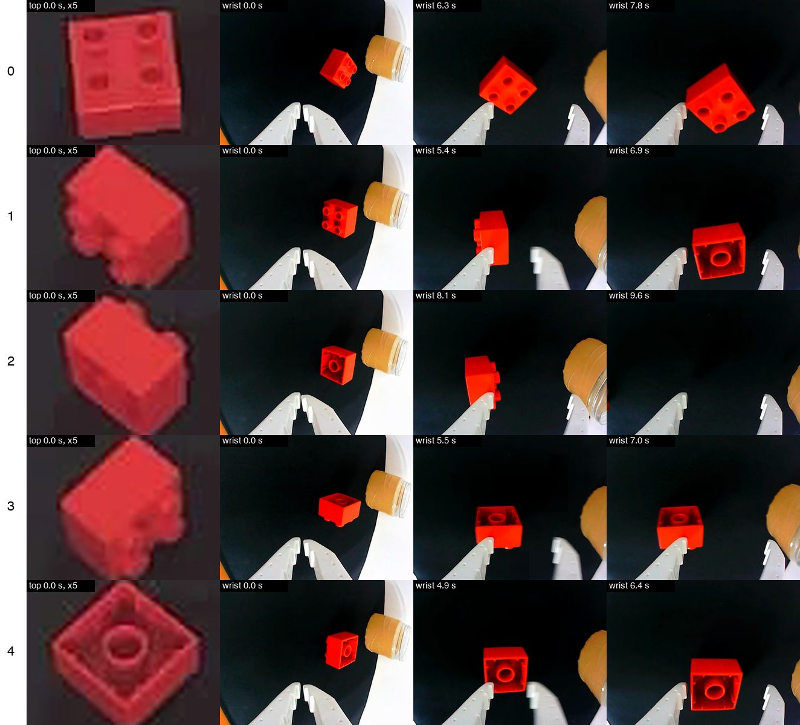
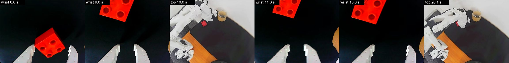
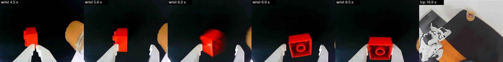
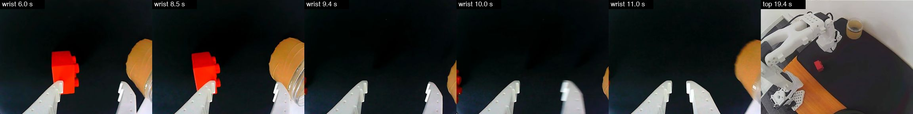
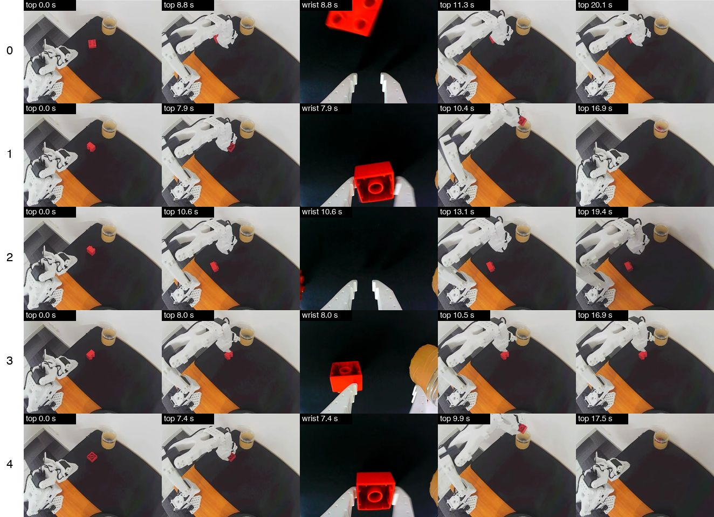

# π0.5 on block-container with the block turned or tipped: 2 of 5

With the block at one demo spot but lying five different ways, the π0.5 policy placed it in 2 of 5 attempts. It placed the block upside down, and it placed one block lying on its side after its own jaw knocked that block over onto its top. It failed on the block turned 45° and on the other two lying on their sides.

[ACT ran the same test](act-block-container-block-orientations.md) next and also placed 2 of 5, but not the same two.

## Setup

| | |
| --- | --- |
| Command | `uv run so101 run --policy pi05 --remote --episodes 5` |
| Policy | `gpahal/pi05_so101_block-container` at `100-demos` (commit `30f7e126`), the same model as in the [review with the usual block](pi05-block-container-full-fine-tune.md) |
| Server | Hugging Face Jobs L4: bfloat16, guided real-time chunking, unused action columns pinned |
| Training data | 100 demos in 10 sessions. In every one the block stands upright with its studs up, turned the same way at each spot |
| Block | At spot B, the centre spot, in all 5 attempts, within 12 px of the spot's centre in the top camera's picture. A different way up in each attempt, listed below |
| Jar | In its usual place, within 10 px of the demos |
| Attempt limit | 30 s; every attempt was ended with right arrow before it |
| Lighting | Top camera brightness 116 to 120 of 255 at the start of each attempt (the demos read about 86) |
| Top camera | Out of place by 8 to 9 px |
| Connection | 631 ms on average for a plan, 841 ms at worst; no stalls |

With the usual block, this model placed 5 of 5 at spot B.

## Results

| Attempt | How the block lay | Gripper closed to | Outcome |
| --- | --- | --- | --- |
| 0 | upright, turned 45° | 13, twice | **failed**: the jaws closed on its corners and it slid out ahead of them |
| 1 | on its side, studs towards the arm | 18 | **placed**, after the left jaw tipped it over onto its top |
| 2 | on its side, studs away from the arm | 3 to 7, on nothing | **failed**: the left jaw pushed it out of reach |
| 3 | on its side, studs to the arm's right | never closed | **failed**: stayed over it with open jaws |
| 4 | upside down, studs on the mat | 19 | **placed** |

Outcomes were judged from the camera frames: the block's place on the wrist camera before and after the gripper closed, and in the jar or on the mat on the top camera at the end. The gripper position agrees: it stopped at 18 to 19 in the two attempts that held the block, the width it holds the upright block at.

## Each attempt

**Attempt 0, turned 45°.** The arm came down over the block as it does at this spot, with the block between its jaws but corner-on. When the jaws closed, at 8.5 s, they met two corners instead of two flat sides, and the block slid forward out of them. The gripper closed to 13 with nothing in it, the arm lifted empty, came back, closed again at 11.5 s with the same result, and then stayed over the block with open jaws until the attempt was ended at 20.2 s. By then the block was two block widths from where it started. The wrist never turned to line the jaws up with the block: its roll stayed at -2° to -3° in all five attempts.

**Attempt 1, on its side with the studs towards the arm.** As the arm came down, the tip of the left jaw caught the block and rolled it over onto its studs. From 6.9 s it lay upside down between the jaws. The policy grasped it at 8 s, at a width of 18, and placed it at 12.5 s. The arm was back at rest by 16 s. So this is a placement of an upside-down block that the arm made by accident, not of a block on its side.

**Attempt 2, on its side with the studs away from the arm.** The left jaw's tip touched the block again, and this time pushed it sideways instead of rolling it. By 9.4 s it was out of the wrist camera's picture. The gripper closed on nothing at 10 s and stayed shut until the attempt was ended at 19.5 s. The block ended about two and a half block widths from where it started.

**Attempt 3, on its side with the studs to the right.** The arm stopped with the block at the tip of its left jaw and its jaws open, from 5.5 s to the end at 17.0 s, creeping forward by 3° of shoulder lift. It never closed. This is the same stall the model shows at the far-right spot with the usual block, and at three spots without the mat.

**Attempt 4, upside down.** The grasp, carry and release were as with the upright block: held from 7.5 s at a width of 19, let go over the jar at 13 s, back at rest by 16 s.

## What the attempts have in common

- **The reach never changed.** Base angle, shoulder lift and elbow as the jaws opened over the block were the same in all five attempts, within 3°. The policy went to where the block was and did what it does there.
- **What decided the outcome was the block's outline between the jaws.** Upside down, the block has the same square outline at the same height: placed. Turned 45°, the jaws met corners: lost. On its side, the block is taller and narrower and its top edge sits where the jaw tips pass: knocked over, pushed away, or not grasped.
- **Nothing shows the policy noticing the difference.** It didn't turn its wrist, open wider or come in higher for any of them.

## Compared with ACT

| How the block lay | π0.5 | ACT |
| --- | --- | --- |
| upright, turned 45° | failed: slid out of the closing jaws | **placed**: the closing jaws squared it up |
| on its side, studs towards the arm | **placed**, after tipping it upside down | failed: grasped twice, lost it on lifting twice |
| on its side, studs away from the arm | failed: pushed away | failed: closed beside it |
| on its side, studs to the right | failed: never closed | failed: closed beside it |
| upside down | **placed** | **placed** |

Both placed 2 of 5, and both placed the upside-down block. The turned block separates them by a few millimetres of where the jaws closed, not by anything either policy did differently on purpose. Neither policy picked up and placed a block that was still on its side.

## What this doesn't show

- **A rate.** Each way up was tried once, at one spot.
- **Whether the camera being 8 to 9 px out of place mattered.** The reach matched the demos, and the upside-down block was placed, so it didn't stop the task. The earlier reviews had the camera within 3 px.

## Next

- To handle a block turned or lying on its side, record demos with it that way, and with the wrist turning to match. All 100 demos have one way up and no wrist roll.
- To get a rate, run each way up 5 times.

## Frames

One row per attempt, from left: top camera at the start, top camera and wrist camera at 8 s or when the gripper first closed, top camera 2.5 s later, top camera at the end. Each frame is labelled with its camera and time.

