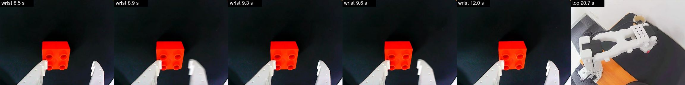
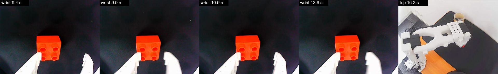
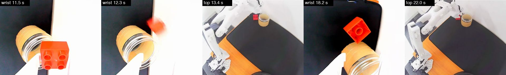
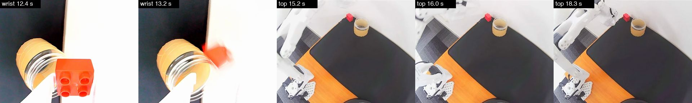
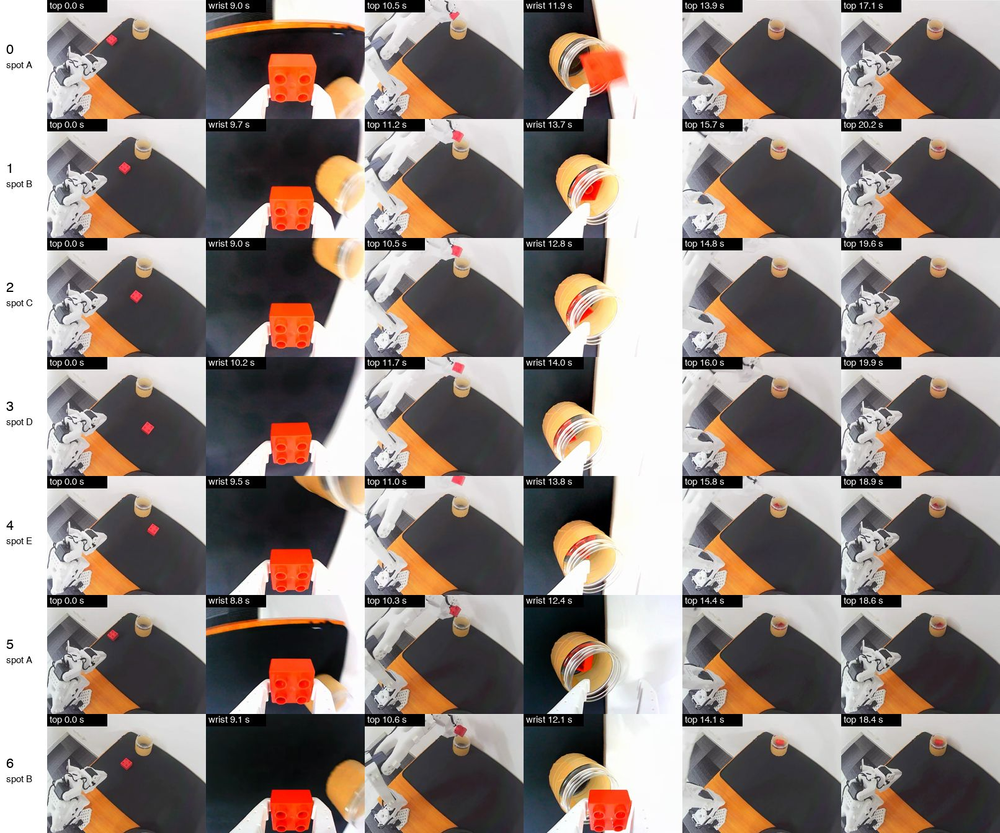
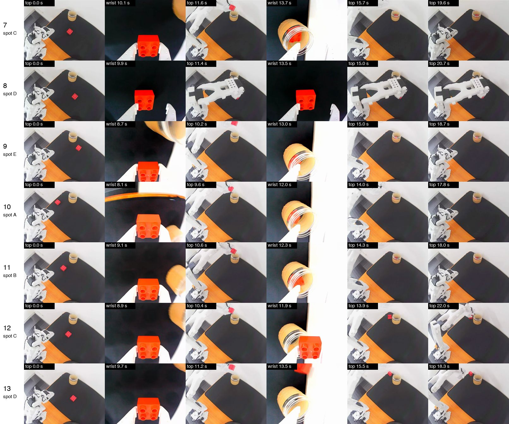
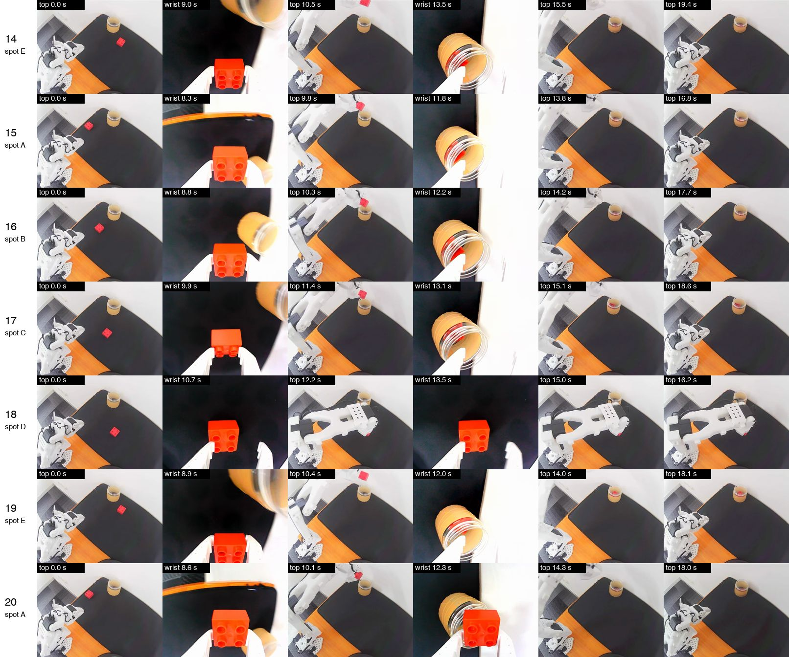
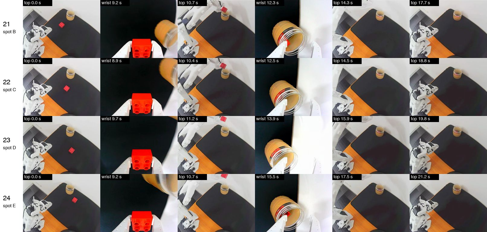

# π0.5 on block-container: 21 of 25 (2026-11-14)

The π0.5 policy trained with the full fine-tune recipe put the block in the jar in 21 of 25 attempts, 5 at each of the 5 block spots used for the demos. Three of the four failures were at the far-right spot. Two of them never lifted the block: the gripper stopped short of it, pinched its near edge and let go, again and again. The other two carried the block to the jar and let go over its rim, so it fell beside the jar. The room was much brighter than in the demos for the whole run: the top camera read 125 to 144 of 255, against 86.

## Setup

| | |
| --- | --- |
| Command | `uv run so101 run --policy pi05 --remote --episodes 25`, started 10:37, finished 10:49 |
| Policy | `gpahal/pi05_so101_block-container` at `100-demos` (commit `30f7e126`): 30,000 steps from `lerobot/pi05_base`, whole model trained, 32-bit weights, image augmentation, averaged weights |
| Server | Hugging Face Jobs L4, started with `uv run so101 server start --policy pi05`: bfloat16, guided real-time chunking, unused action columns pinned |
| Training data | 100 demos in 10 sessions, recorded 2026-11-12, the same as the ACT baseline |
| Attempt limit | 30 s; every attempt was ended with right arrow before it |
| Block spots | Cycled through the 5 spots of the demos, in order: A, B, C, D, E |
| Lighting | Brighter than the demos: top camera brightness 125 to 144 of 255 at the start of every attempt (the demos read about 86). See [Lighting](#lighting) |
| Control loop | 29.98 Hz against 30; no tick over its 33 ms budget |
| Connection | 617 ms on average from sending the cameras' frames to receiving a plan, 965 ms at worst; one stall, in episode 15 |

One more attempt ran and isn't counted: the first try at episode 24 was thrown away with left arrow after 14.8 s and repeated. Its frames weren't saved, so its outcome can't be judged here.

The spots are the same five as in the [ACT baseline](act-block-container-baseline.md). Each attempt's block started within 31 pixels of the centre of its spot's 20 demos in the top camera's picture:

| Spot | Where | Pan at the grasp |
| --- | --- | --- |
| A | left | -13° |
| B | centre | 2° |
| C | right, near | 18° |
| D | far right | 30° |
| E | right, further out (elbow at -28° to -33°) | 19° |

## Results

| Spot | Episodes | Placed | Notes |
| --- | --- | --- | --- |
| A | 0, 5, 10, 15, 20 | 5/5 | 15 paused for 0.7 s with the block in its jaws, when a plan arrived late |
| B | 1, 6, 11, 16, 21 | 5/5 | |
| C | 2, 7, 12, 17, 22 | 4/5 | 12 failed; 17 held the block by its edge and still placed it |
| D | 3, 8, 13, 18, 23 | 2/5 | 8, 13 and 18 failed |
| E | 4, 9, 14, 19, 24 | 5/5 | |

A clean attempt closes on the block at 7 to 9 s, opens over the jar at 12 to 16 s (13.0 s at the median) and is back at rest at 15 to 19 s (16.2 s at the median). The 21 placed attempts ran a median of 18.7 s from start to the right arrow, against 19.1 s for the demos.

| Episode | Spot | Length | Outcome |
| --- | --- | --- | --- |
| 0 | A | 17.2 s | placed |
| 1 | B | 20.3 s | placed |
| 2 | C | 19.7 s | placed |
| 3 | D | 20.0 s | placed |
| 4 | E | 19.0 s | placed |
| 5 | A | 18.7 s | placed |
| 6 | B | 18.5 s | placed |
| 7 | C | 19.7 s | placed |
| 8 | D | 20.8 s | **failed**: pinched the block's near edge and let go, never lifted it |
| 9 | E | 18.8 s | placed |
| 10 | A | 17.9 s | placed |
| 11 | B | 18.1 s | placed |
| 12 | C | 22.1 s | **failed**: let go over the jar's rim, and the block fell beside the jar |
| 13 | D | 18.4 s | **failed**: let go over the jar's rim, and the block fell beside the jar |
| 14 | E | 19.5 s | placed |
| 15 | A | 16.9 s | placed, after a 0.7 s pause |
| 16 | B | 17.8 s | placed |
| 17 | C | 18.7 s | placed, holding the block by its edge |
| 18 | D | 16.3 s | **failed**: pinched the block's near edge and let go, never lifted it |
| 19 | E | 18.2 s | placed |
| 20 | A | 18.1 s | placed |
| 21 | B | 17.8 s | placed |
| 22 | C | 18.9 s | placed |
| 23 | D | 19.9 s | placed |
| 24 | E | 21.3 s | placed |

Outcomes were judged from the camera frames: the block in the jaws on the wrist camera 1 s after the gripper closed, and in the jar on the top camera after the release and in an enlarged crop of the jar from the last frame. The jar was empty at the start of every attempt. The gripper position confirms each one. Holding the block, the gripper stops at 18.3 to 19.0, as in the ACT baseline; with nothing in it, it closes to 1; in episode 17, on the block's edge, it stopped at 15.1.

## The failures

**Episodes 8 and 18 (spot D): the gripper stopped short of the block.** In both, the arm came down with its jaws open and the block just beyond their tips, against the left jaw, instead of between them. The jaws closed on the block's near edge for 0.3 to 0.5 s, reaching a width of 14 to 23, and opened again without lifting. Episode 8 did this twice and then held its jaws open around the block for the remaining 11 s, creeping forward (shoulder lift from 24° to 33°). Episode 18 did it seven times in 5 s. Neither was at the 30 s limit when it was ended, at 20.8 s and 16.3 s.

**Episodes 12 (spot C) and 13 (spot D): let go over the jar's rim.** Both grasped cleanly, at a width of 19, and carried the block to the jar. Both opened with the block over the jar's rim instead of its mouth, and the block fell on the mat beside the jar. The arm's joints at the release were inside the range of the 21 placed attempts (shoulder lift 28° to 29°, elbow -26° to -29°), so the miss is a matter of a centimetre or two, not a different pose. Both then went back for the block and were ended before they had it: episode 12 hovered over it with open jaws from 16 s and was closing on it when the attempt ended at 22.1 s; episode 13 started back to rest, turned round at 16.5 s and was reaching for the block when the attempt ended at 18.4 s.

Spot D is the weak spot for both policies. It has 3 of this run's 4 failures and the ACT baseline's only failure, and in all of ACT's misses and both of these stuck attempts the block ended up at the left jaw. Two policies trained on the same demos failing the same way suggests the cause is in the demos or the arm's reach at that spot, which this run doesn't test.

## Other events

- **Episode 15, a late plan.** 8 s in, one request took longer than the 1 s of motion the arm had queued. The arm held still for 0.7 s with the block in its jaws, then carried on and placed it. It was the only stall in 12 minutes.
- **Episode 17, an edge grasp.** The jaws closed on the near end of the block, at a width of 15.1 instead of 19. The block stayed in the jaws and went in the jar.
- **Episode 13, a change of plan.** When the policy turned back for the dropped block, its command jumped 15° between two frames. The arm moved at most 3.1° in a frame, because each command is capped at 10° from where the arm is.

## Motion

Measured the same way on both runs, from the commands sent to the arm:

| | π0.5, this run | ACT baseline |
| --- | --- | --- |
| Shoulder lift direction changes per placed attempt | 10 at the median (3 to 18) | 9 at the median (3 to 15) |
| Largest command step between two frames, placed attempts | 2.4° to 5.4° | 3.0° to 12.1° |
| Largest movement of the arm between two frames | 2.4° to 3.1° | 2.2° to 3.4° |

π0.5 now moves as smoothly as ACT. The first π0.5 model, trained for 12,000 steps with only the action model unfrozen, changed direction 54 to 88 times per attempt without the pin and 15 to 16 times with it, in five attempts on 2026-11-13.

## Lighting

The run was in morning daylight, and the demos were recorded in the afternoon under the room's lights. The cameras' exposure is fixed, so the pictures were brighter:

| | Demos | ACT baseline | This run |
| --- | --- | --- | --- |
| Top camera brightness at the start of an attempt, of 255 | 86 | 95 to 100 | 125 to 144 |
| Top camera pixels at full white | 0.0% | 0.1% | 0.1% to 2.1% |
| Wrist camera pixels at full white at the start of an attempt | 0.0% | under 1% | 18% to 33% |

The light also changed during the run: episodes 5 to 8, 21, 23 and 24 read 125 to 130, and the others 138 to 144. The failures don't follow it: they read 129, 143, 144 and 139.

The policy was trained with random brightness changes of up to 20% and had never seen pictures this bright. It placed 21 of 25 anyway.

## Compared with the ACT baseline

| | ACT (2026-11-13, 13:09) | π0.5 (this run) |
| --- | --- | --- |
| Placed | 24 of 25 | 21 of 25 |
| By spot (A, B, C, D, E) | 5, 5, 5, 4, 5 | 5, 5, 4, 2, 5 |
| Missed first grasps that recovered | 2 | 0 |
| Lighting (top camera) | 95 to 100, close to the demos | 125 to 144 |
| Where the policy ran | The Mac's GPU, 100 action steps per prediction | An L4 in the cloud, a new plan about every 0.6 s |

This doesn't show which policy is better. A gap of 3 in 25 is within what chance gives (Fisher's exact test, p = 0.35), and the two runs were in different light. ACT has only been run in bright light once, on 2026-11-13 in warmer and brighter light than this (brightness 155, 37% of the top camera's pixels at full white), where it placed 4 of 11.

The policies fail differently. ACT's misses were all first grasps beside the block, and it recovered from 2 of 3. π0.5 grasped the block in 23 of 25 attempts at the first try, and lost 2 of those 23 at the jar.

## Next

- Run both policies in the same light, 25 attempts each, to compare them directly.
- Let a failed attempt run to the 30 s limit. Episodes 12 and 13 were going back for the block when they were ended, at 22.1 s and 18.4 s.
- Record 10 to 20 more demos at spot D, with the gripper well past the block before it closes. Both policies stop short of the block there.

## Frames

One row per attempt, from left: top camera at the start, wrist 1 s after the gripper first closed, top 2.5 s after it closed, wrist 0.5 s before the release, top 1.5 s after the release, top at the end. Episodes 8 and 18 never carried the block, so their fourth and fifth frames are at 13.5 s and 15 s. Each frame is labelled with its camera and time.

