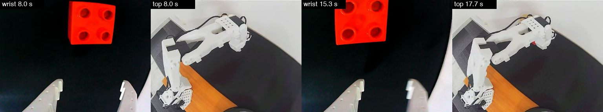
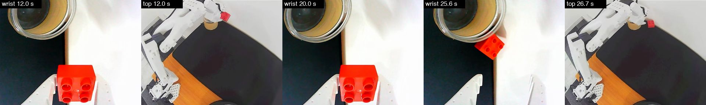
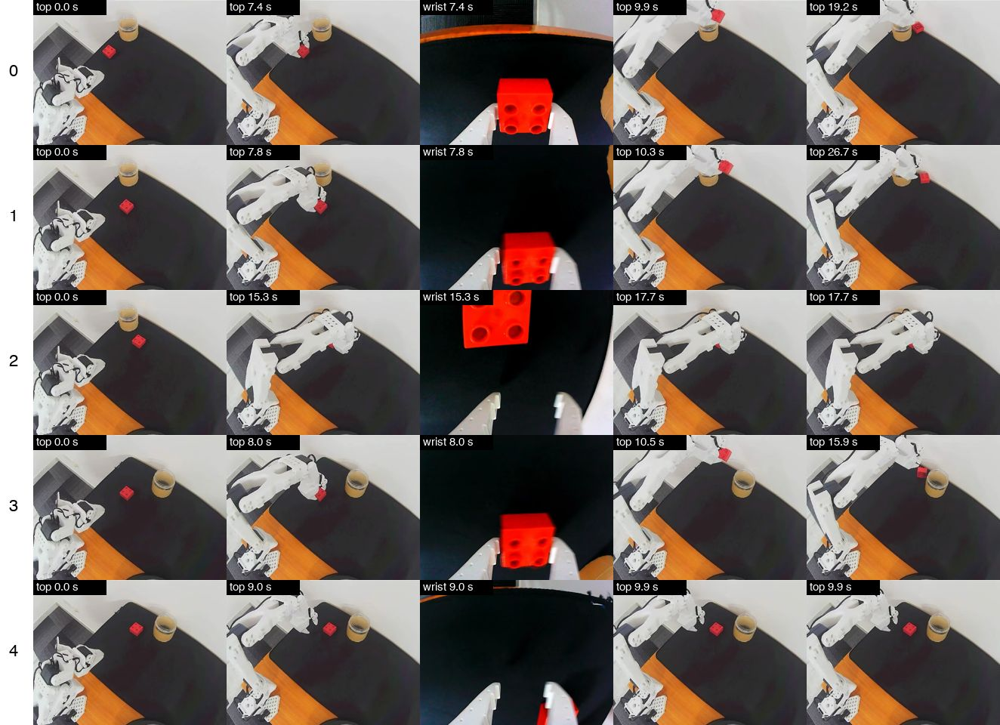

# π0.5 on block-container with the jar moved: 0 of 5

With the jar moved about one jar width from its place in the demos, the π0.5 policy placed the block in none of 5 attempts. It picked the block up in all 3 attempts where the block was at a demo spot, carried it to where the jar used to be, and let go there, beside the jar. In the 2 attempts with the block at a new spot, it didn't pick the block up.

This is the same test as [ACT with the jar moved](act-block-container-moved-container.md), run next on the same five placements as its second run.

## Setup

| | |
| --- | --- |
| Command | `uv run so101 run --policy pi05 --remote --episodes 5` |
| Policy | `gpahal/pi05_so101_block-container` at `100-demos` (commit `30f7e126`), the same model as in the [in-place review](pi05-block-container-full-fine-tune.md) |
| Server | Hugging Face Jobs L4: bfloat16, guided real-time chunking, unused action columns pinned |
| Training data | 100 demos in 10 sessions. The jar is in one place in all of them |
| Jar | Moved by about its own width: 74 px to the left for attempts 0 to 2, 62 px to the right and nearer the arm for attempts 3 and 4 |
| Block | At demo spots A, B and B in attempts 0, 1 and 3 (within 3 px of a demo's block). In attempts 2 and 4, 45 to 47 px from the nearest demo, about one and a half block widths |
| Attempt limit | 30 s; every attempt was ended with right arrow before it |
| Lighting | Top camera brightness 118 to 122 of 255 at the start of each attempt (the demos read about 86) |
| Top camera | Out of place: the scene sat 7 px from where it is in the demos, in a picture 640 px wide |
| Connection | 623 ms on average for a plan, 901 ms at worst; one stall, 3 s into attempt 2 |

One more attempt was thrown away with left arrow after 12.5 s and repeated as attempt 4. Its frames weren't saved.

Two earlier tries at this run ended 15 s and 10 s into their first attempt. Plans took 0.85 to 1.14 s to arrive over the network, against the usual 0.62 s, and a run stops when the arm has had nothing to play for 2 s. The server answered in 0.37 s throughout, as it does when the connection is normal.

Distances are in pixels of the top camera's picture, measured in the first frame of each attempt and corrected for the camera being out of place. The jar is about 70 px wide there.

## Results

| Attempt | Jar moved | Block | Picked up | What happened |
| --- | --- | --- | --- | --- |
| 0 | 74 px left | spot A | yes, at 7.4 s | carried to the jar's old place, let go at 14 s; block on the mat beside the jar |
| 1 | 74 px left | spot B | yes, at 7.8 s | held over the jar's old place for 13 s, let go at 24 s; block on the mat against the jar |
| 2 | 74 px left | new spot, 47 px from spot B | no | stopped short with its jaws open and crept towards the block for 10 s |
| 3 | 62 px right | spot B | yes, at 8.0 s | carried to the jar's old place, let go at 13 s; block on the mat beside the jar |
| 4 | 63 px right | new spot, 45 px from spot B | no | closed on the block's edge at 9.0 s; ended at 10.0 s |

Outcomes were judged from the camera frames: the block in the jaws on the wrist camera when the gripper closed, and where it lay on the top camera at the end. The gripper position agrees: it stopped at 18.7 to 18.9 in the three attempts that held the block, as in the in-place review.

## Where it found the block

At the three demo spots the arm aimed where the demos do, whichever way the jar had moved:

| Attempt | Spot | Base angle at the grasp | In the nearest demos |
| --- | --- | --- | --- |
| 0 | A | -14° | -15° |
| 1 | B | 2° | 3° |
| 3 | B | 1° | 1° |

ACT, on the same three placements, aimed 19°, 18° and 7° off and closed beside the block. So π0.5 finds the block from the block, and the jar's place doesn't pull its reach.

It only found the block where it had seen one, though. With the block one and a half block widths from any demo:

- **Attempt 2** came down with the block beyond the tips of its open jaws and never closed on it. Over 10 s it crept forward (shoulder lift from 23° to 45°) without getting there. This is what it did at the far-right spot in the in-place review.
- **Attempt 4** closed with the block against the outside of its right jaw, to a width of 17 to 18. It was ended a second later, so the frames don't show whether it would have lifted.

## Where it let go

In all three carries the arm went to the pose the demos release from, and not to the jar:

| Attempt | Base, shoulder lift, elbow at the release | Demos (median) |
| --- | --- | --- |
| 0 | 0°, 32°, -31° | 1°, 30°, -27° |
| 1 | 1°, 29°, -26° | |
| 3 | 2°, 28°, -25° | |

The jar was in the wrist camera's picture each time, off to one side. In attempt 1 the arm held the block beside it from 11 s to 24 s before opening. In the in-place review every release came by 16 s, so the policy did react to the jar not being under the block, by waiting. It didn't move over it.

## Compared with ACT

| | ACT (two runs) | π0.5 |
| --- | --- | --- |
| Placed | 0 of 10 | 0 of 5 |
| Block at a demo spot: picked up | 0 of 6 | 3 of 3 |
| Block at a new spot: picked up | 0 of 4 | 0 of 2 |
| Aim at a demo spot | 7° to 22° off | within 1° |
| Where it took the block | never carried one | the jar's old place, 3 of 3 |

Both policies were trained on the same 100 demos, where the jar never moves and the block starts in five small areas. Neither learned to go to the jar, and neither reaches a block outside those areas. π0.5's one advantage here is that a moved jar doesn't disturb its grasp.

## What this doesn't show

- **How far the jar can move before π0.5 misses it.** Only one distance was tried, about one jar width.
- **How far from a demo spot a block can be.** Both new spots were about one and a half block widths out. In the in-place review, blocks up to 31 px from a spot's centre were picked up.
- **Anything with confidence.** This is 5 attempts.

## Next

- Record demos with the jar in several places and the block spread over the mat, not at five spots. Both failures come from what the demos hold still.
- Put the top camera back before any more runs.

## Frames

One row per attempt, from left: top camera at the start, top camera and wrist camera when the gripper first closed, top camera 2.5 s later, top camera at the end. In attempt 2 the gripper never closed on the block, so its frames are from 15.3 s on. Each frame is labelled with its camera and time.

