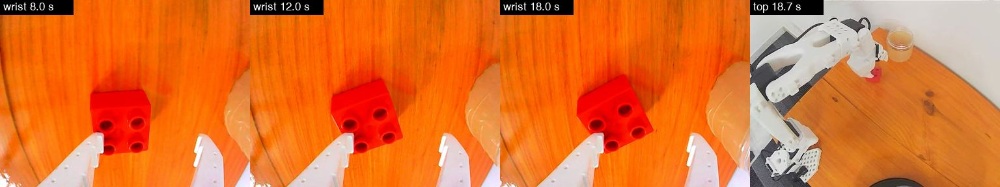
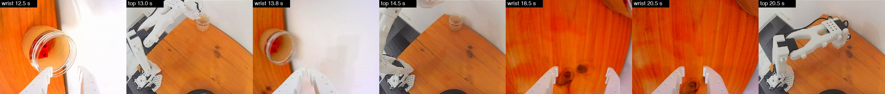
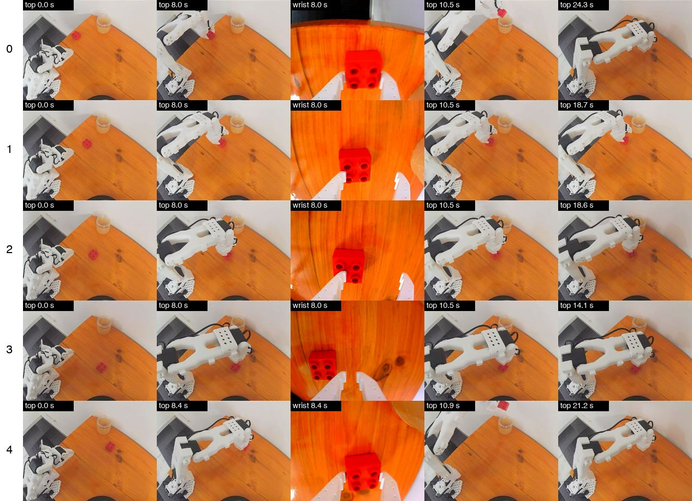

# π0.5 on block-container without the mat: 2 of 5

With the black mat taken away and the block and jar on the bare wooden table, the π0.5 policy placed the block in 2 of 5 attempts, one at each of the 5 demo spots. In the other 3 it reached the block and stayed over it with its jaws open, never closing. After both placements it didn't go back to rest: it reached for two dark knots in the wood and closed its gripper on them.

[ACT ran the same test](act-block-container-no-mat.md) next and placed none.

## Setup

| | |
| --- | --- |
| Command | `uv run so101 run --policy pi05 --remote --episodes 5` |
| Policy | `gpahal/pi05_so101_block-container` at `100-demos` (commit `30f7e126`), the same model as in the [review with the mat](pi05-block-container-full-fine-tune.md) |
| Server | Hugging Face Jobs L4: bfloat16, guided real-time chunking, unused action columns pinned |
| Training data | 100 demos in 10 sessions, all on the black mat |
| Surface | The bare wooden table: orange-brown, with visible grain and two dark knots near spot E. The block also sits lower than in the demos, by the mat's thickness |
| Jar | In its usual place, within 9 px of the demos in the top camera's picture |
| Block spots | The 5 spots of the demos, in order: A, B, C, D, E. At A, B and E the block was within 8 px of a demo's block; at C it was 22 px off and at D 39 px |
| Attempt limit | 30 s; every attempt was ended with right arrow before it |
| Lighting | Top camera brightness 133 to 150 of 255 at the start of each attempt (the demos read about 86). The wood is brighter than the mat. With the mat, this model placed 21 of 25 at a brightness of 125 to 144 |
| Top camera | In place: 1 to 4 px from where the scene is in the demos |
| Connection | 632 ms on average for a plan, 897 ms at worst; no stalls |

## Results

| Attempt | Spot | Picked up | Outcome |
| --- | --- | --- | --- |
| 0 | A | yes, at 8.0 s | **placed** at 12 s, then reached for the knots |
| 1 | B | no | over the block with its jaws open from 5.4 s to the end, at 18.8 s |
| 2 | C | no | over the block with its jaws open from 6.8 s to the end, at 18.7 s |
| 3 | D | no | opened its jaws late, at 9.9 s, and stayed over the block until the end, at 14.2 s |
| 4 | E | yes, at 8.4 s | **placed** at 12 s, then reached for the knots |

Outcomes were judged from the camera frames: the block in the jaws on the wrist camera when the gripper closed, in the jar on both cameras after the release, and on the table at the end of the other three. The gripper position agrees: it stopped at 18.7 holding the block in attempts 0 and 4, and never went under 25 in the other three.

With the mat this model placed 21 of 25: 5 of 5 at A, B and E, 4 of 5 at C and 2 of 5 at D.

## The three that never closed

The arm aimed at the block each time. In attempt 1 it was at the pose the demos grasp from at spot B:

| Attempt | Spot | Base, shoulder lift, elbow while over the block | Demos at the grasp |
| --- | --- | --- | --- |
| 1 | B | 2°, 16°, 12° | 3°, 18°, 12° |
| 2 | C | 16°, 20°, 5° | 13°, 11°, 22° |
| 3 | D | 30°, 21°, 4° | 34°, 34°, -14° |

In all three the block sat at the tip of the left jaw instead of between the jaws, and the gripper stayed open. The arm crept forward by a few degrees over 10 s or more and nudged the block without closing on it. This is what the model did in its two stuck attempts at spot D with the mat, where it at least pinched the block's edge. Here it didn't close at all.

## After placing: the knots

In attempts 0 and 4 the grasp, the carry and the release were as they are with the mat: held from 8 s, over the jar and let go at 12 s, at the demos' release pose. The block went in the jar both times.

With the mat the arm is then back at rest by 15 to 19 s. Here it wasn't. It lowered partway, turned to a base angle of 20° to 22°, and came down with open jaws around two dark knots in the wood. In attempt 0 it closed on them to a width of 10 to 16 and opened again. Attempt 0's block had been at spot A, at a base angle of -15°, so the arm wasn't going back to where it had picked the block up.

Nothing on the mat looks like those knots, and the policy has never seen the task end with something still on the table. It treated them as something left to pick up.

## Compared with ACT

| | ACT | π0.5 |
| --- | --- | --- |
| Placed | 0 of 5 | 2 of 5 |
| Picked up the block | 0 of 5 | 2 of 5 |
| Reached the block | 3 of 5 | 5 of 5 |
| Shoulder lift direction changes per attempt | 64 to 191 | 3 to 34 |

π0.5 kept its smooth motion and its aim on the new surface, and did the whole task twice. ACT's motion broke down, and in 2 attempts it never left its start pose.

## What this doesn't show

- **Whether the picture or the height matters.** Taking the mat away changes what the cameras see and lowers the block by the mat's thickness. This run can't separate the two.
- **A rate.** This is 5 attempts, one per spot.

## Next

- To make either policy work on another surface, record demos on more than one surface. All 100 are on the mat.
- To test the picture alone, put a thin sheet of another colour over the mat, so the block stays at the same height.

## Frames

One row per attempt, from left: top camera at the start, top camera and wrist camera at 8 s or when the gripper first closed, top camera 2.5 s later, top camera at the end. Each frame is labelled with its camera and time.

